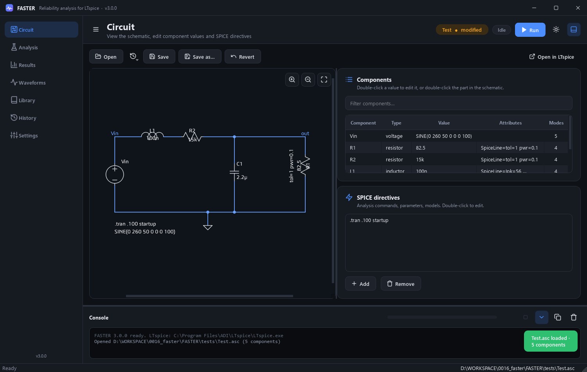
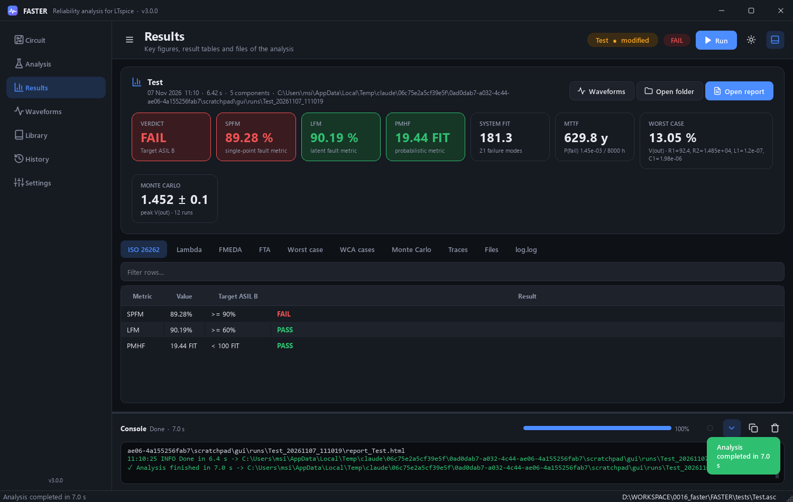
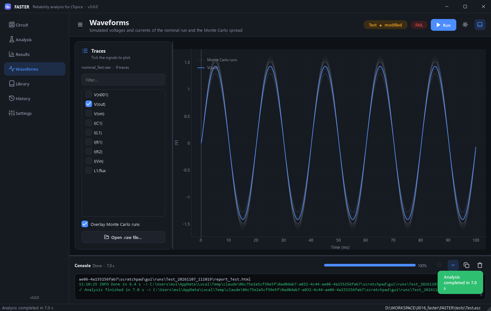
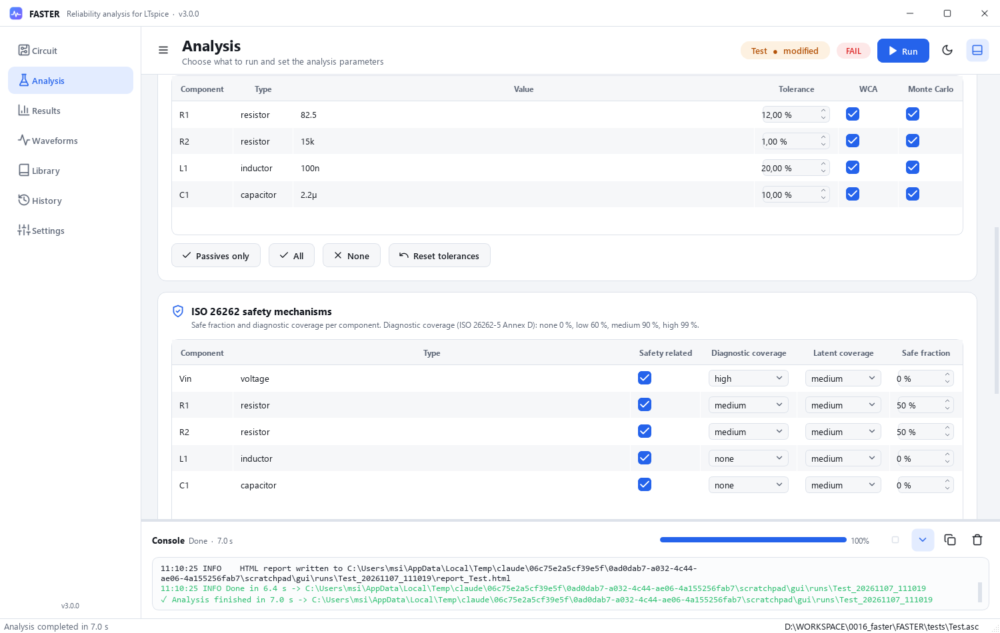

# FASTER (Failure Analysis, Simulation, Testing, and Evaluation Report)

FASTER automates reliability analysis of LTspice circuits. From a single `.asc`
schematic it produces:

- **FMEDA** – failure modes, mechanisms, effects and mission-profile FIT of every component
- **ISO 26262 metrics** – SPFM, LFM and PMHF against the ASIL targets of ISO 26262-5
- **FTA** – fault tree, system FIT, MTTF and failure probability over a mission time
- **Nominal simulation** – every voltage/current trace
- **WCA** – worst-case (corner) analysis of toleranced components
- **Monte Carlo** – statistical tolerance analysis with real LTspice runs
- **HTML report** – one self-contained, interactive (Plotly) page with all of the above

Simulations run in parallel through PyLTSpice. Everything is available from a
modern desktop app or from the command line.



## Table of Contents

1. [Installation](#installation)
2. [Data folder](#data-folder)
3. [Desktop app](#desktop-app)
4. [Command line](#command-line)
5. [Configuration](#configuration)
6. [Reliability data](#reliability-data)
7. [ISO 26262 hardware metrics](#iso-26262-hardware-metrics)
8. [Outputs](#outputs)
9. [Project structure](#project-structure)
10. [Building the installer](#building-the-installer)
11. [Using the library](#using-the-library)
12. [License](#license)

## Installation

**Windows installer:** run `FASTER-<version>-setup.exe`. Python is not needed. By
default it installs for the current user without admin rights. You can also
choose "Install for all users". The setup asks for the [data folder](#data-folder)
and can optionally add FASTER to *Open with* for `.asc` files and put
`faster-cli` on the PATH. [LTspice](https://www.analog.com/ltspice) is only
needed for simulations.

**From source:** you need Python ≥ 3.10.

```bash
git clone https://github.com/yourusername/FASTER.git
cd FASTER
pip install -r requirements.txt
```

LTspice is found automatically in the usual install folders. Otherwise set
`"ltspice_path"` in `config.json` or the `FASTER_LTSPICE` environment variable.

## Data folder

FASTER never writes into its program folder, so it can be installed under
*Program Files*. All your work goes into a **data folder** that you choose, by
default `Documents\FASTER`:

```
<data folder>/
  results/        one time-stamped folder per analysis run
  examples/       example circuits (copied on first start)
  config.json     default analysis settings, edit to change the defaults
  work/           only if needed: working copies of edited circuits from read-only folders
```

You choose it in the installer or on the first start of the app, and you can
change it any time in **Settings → Data folder** (existing results are not
moved). The choice is stored in `%APPDATA%\FASTER\preferences.json` and shared by
the app and the command line. Override it per run with `--data-dir DIR` or the
`FASTER_DATA` environment variable. Uninstalling FASTER keeps the data folder.

## Desktop app

```bash
python main.py                    # start the app (reopens the last schematic)
python main.py --gui circuit.asc  # start the app with a schematic
python -m Lib.gui                 # same, as a module
```

The app (PySide6 / Qt 6) shares its design with Flash: custom title bar,
collapsible sidebar, light / dark / system theme, toasts, a live console with
progress bar and Stop, and every setting remembered between sessions.

| Page | What you can do |
|---|---|
| **Circuit** | Open or drop a `.asc`. The schematic is drawn in the app (zoom, pan, hover read-out). Click a part to select it, double-click to edit its value. Edit values in the component table and SPICE directives in the list; the drawing updates instantly. Save, Save as, Revert, Open in LTspice. |
| **Schematic** | Full schematic editor, LTspice compatible: draw wires, place any symbol of the LTspice library, net labels, ground, ports, comments and SPICE directives; move / drag (wires follow), rotate, mirror, copy / paste, undo / redo. Edit attributes and source functions (PULSE, SINE, PWL…), set the simulation command (.tran, .ac, .dc, .noise, .op, .tf), Run, then click wires and parts to plot voltages and currents. See [Schematic editor](#schematic-editor). |
| **Analysis** | Choose the steps (nominal simulation, worst-case, Monte Carlo; FMEDA / ISO 26262 / FTA / report always). Mission profile (temperature, MIL-HDBK-217F environment, mission time), target ASIL, per-component diagnostic coverage / latent coverage / safe fraction, per-component tolerances for WCA and Monte Carlo (defaults from `tol=` in the schematic), output signals, run count, distribution, seed. Shows the number of LTspice simulations before you run. |
| **Results** | KPI cards (verdict, SPFM, LFM, PMHF in green / red, system FIT, MTTF, worst case, Monte Carlo spread) and tabs with every result table (ISO 26262, λ per component, FMEDA, FTA, WCA, Monte Carlo, traces), the output files and `log.log`. Open the HTML report or the run folder. |
| **Waveforms** | Fast native plots of every simulated voltage and current, Monte Carlo runs overlaid, crosshair read-out, any `.raw` file. |
| **Library** | All component classes and failure modes with their sources; override the base FIT of a class (e.g. supplier data). |
| **History** | Every previous run with its verdict and metrics; reopen, open the report or folder, delete. |
| **Settings** | Theme, LTspice executable, output folder, parallel simulations, timeout, what to do when a run finishes. |

Analyses run in a separate process: the window never freezes and **Stop** (Esc)
ends the run and every LTspice instance. Unsaved edits are analysed from a
temporary working copy under the circuit's name, so you can try values without
touching the schematic file.

| Shortcut | Action |
|---|---|
| `Ctrl+1` … `Ctrl+8` | Switch page |
| `Ctrl+N` / `Ctrl+O` / `Ctrl+S` | New / open / save schematic |
| `Ctrl+R` or `Ctrl+Enter` | Run the analysis (on the Schematic page `Ctrl+R` rotates, like LTspice) |
| `F11` | Simulate the schematic in the editor |
| `Esc` | Stop the analysis / leave the current editor tool |
| `Ctrl+J` / `Ctrl+L` | Show / hide console, clear console |
| `Ctrl+T` / `Ctrl+B` | Toggle theme, collapse sidebar |

<p align="center">
  
  
</p>
<p align="center">
  
</p>

### Schematic editor

The **Schematic** page replaces the LTspice schematic window with the FASTER UI.
LTspice is still the simulation engine: on **Run** FASTER asks LTspice to
netlist the schematic (`LTspice -netlist`) and simulates it in batch mode
(`LTspice -b`), then reads the `.raw` file. Files stay plain `.asc`: every line
FASTER does not edit is kept, so circuits open unchanged in LTspice.

| Key | Action | Key | Action |
|---|---|---|---|
| `F2` | Component library | `F3` / `W` | Draw wire |
| `F4` | Net label / port | `G` | Ground |
| `R` `C` `L` `D` | Resistor, capacitor, inductor, diode | `T` / `S` | Comment / SPICE directive |
| `Ctrl+R` / `Ctrl+E` | Rotate / mirror | `F5` / `Del` | Delete |
| `F6` | Duplicate | `F7` / `F8` | Move (detach) / drag (wires follow) |
| `Ctrl+Z` `F9` / `Ctrl+Y` `Shift+F9` | Undo / redo | `Ctrl+X` `Ctrl+C` `Ctrl+V` | Cut, copy, paste |
| `P` | Probe | `Space` | Zoom to fit |
| `F11` | Run | `Esc` / right-click | Stop the current tool |

Mouse: wheel zooms, middle or right drag pans, drag on empty space selects
(left-to-right: inside, right-to-left: touching), double-click edits.
After a run the probe is active: click a wire for `V(net)`, a part for its
current, or type any trace in the waveform pane. AC results show magnitude (dB)
and phase, `.step` runs one curve per step, `.op` opens the operating-point
table. The SPICE error log and the netlist are one click away.

## Command line

```bash
python main.py tests/Test.asc                   # full analysis (installed: faster-cli Test.asc)
python main.py circuit.asc --no-sim             # FMEDA + FTA only (no LTspice needed)
python main.py circuit.asc --mc-runs 500 --open # more Monte Carlo runs, open the report
```

| Option | Description |
|---|---|
| `-c, --config FILE` | configuration file (default `config.json` of the data folder) |
| `-o, --output DIR` | output root (default `<data folder>/results`) |
| `--data-dir DIR` | data folder for this run (default: the one chosen in the app) |
| `--name NAME` | circuit name used for the run folder and output files |
| `--image FILE` | use this picture instead of the automatic schematic export |
| `--mc-runs N` | override the Monte Carlo run count |
| `--no-sim`, `--no-wca`, `--no-mc` | skip all simulations / WCA / Monte Carlo |
| `--keep-sims` | keep the generated netlists and `.raw` files |
| `--open` | open the report in the browser when done |
| `--no-tables` | do not print result tables in the terminal (`log.log` still has them) |
| `-v, --verbose` | debug logging |

## Configuration

`config.json` (all keys optional, defaults in [Lib/core/config.py](Lib/core/config.py)):

```json
{
    "ltspice_path": null,
    "parallel_sims": 4,
    "sim_timeout": 600,
    "reliability": { "temperature_c": 55, "environment": "GM", "fit_overrides": { "U1": 12.5 } },
    "iso26262": {
        "target_asil": "B",
        "not_safety_related": ["R7"],
        "safe_fraction":       { "resistor": { "drift high": 0.5 } },
        "diagnostic_coverage": { "Vin": { "*": "high" }, "resistor": { "open circuit": "medium" } },
        "latent_coverage":     { "*": { "*": 0.9 } }
    },
    "fta":  { "mission_hours": 8000 },
    "wca": {
        "analysis_type": "passive",
        "components": { "R1": 12, "R2": { "tolerance": 1, "nominal": "11.5k" } },
        "output_variables": ["V(out)", "I(R1)"],
        "max_corner_components": 8
    },
    "montecarlo": {
        "runs": 50,
        "distribution": "uniform",
        "seed": 42,
        "output_variable": "V(out)",
        "tolerances": { "R1": 5, "R2": 10 }
    }
}
```

- Tolerances are in **percent**. In WCA, `"analysis_type": "active"` means the
  tolerance is an absolute value (nominal ± tolerance).
- `nominal` is optional: by default it is read from the schematic. SPICE suffixes
  (`k`, `meg`, `u`, `n` ...) are accepted.
- WCA simulates all 2^N corners up to `max_corner_components`, and varies one
  component at a time above that.
- Monte Carlo `distribution`: `uniform`, or `gaussian` with 3σ = tolerance.
- The old single-component `cmpt.json` format is still accepted.

## Reliability data

The knowledge base lives in `Lib/knowledge/` and covers 26 component classes
(sources, battery, resistor, MLCC, electrolytic, inductor, ferrite bead,
transformer, crystal, fuse, diode, zener, TVS, Schottky, LED, BJT, MOSFET,
JFET, IGBT, thyristor, op-amp/comparator, IC, relay, switch, connector).

- **Failure modes** (`failures.py`): each mode has its share of the component
  failure rate, the physical mechanism and the local effect. Distributions follow
  RIAC FMD-2016 and MIL-HDBK-338B; failure modes to consider follow ISO 26262-5
  Annex D and ISO 26262-11 (semiconductor fault models). Splits that are not in a
  published table are marked `derived` in the `Mode Source` column.
- **FIT rates** (`fit_rates.py`): typical base FIT at reference conditions
  (40 °C, ground benign, automotive-grade parts) from the handbooks ISO 26262-5
  §8.4.3 accepts: SN 29500, IEC 61709 and MIL-HDBK-217F.
- **Mission profile**: `FIT = base × π_T × π_E`, with π_T an Arrhenius factor
  (IEC 61709 approach, one activation energy per class) and π_E the
  MIL-HDBK-217F environment factor (`GB`, `GF`, `GM` = automotive, `NS`, `AIC`,
  `AUF`, `SF`, `ML` ...).
- `fit_overrides` replaces the base FIT of a type or of one designator (e.g. a
  supplier FIT for an IC).

These are generic values. For a safety case, replace them with supplier data,
field data or your company's reliability handbook.

## ISO 26262 hardware metrics

`Lib/analysis/iso26262.py` classifies every FMEDA failure mode
(ISO 26262-5 Annex B) and computes the hardware architectural metrics:

| Metric | Formula | ASIL B | ASIL C | ASIL D |
|---|---|---|---|---|
| SPFM | 1 − Σ(λ_SPF + λ_RF) / Σλ | ≥ 90 % | ≥ 97 % | ≥ 99 % |
| LFM | 1 − Σλ_MPF,latent / Σ(λ − λ_SPF − λ_RF) | ≥ 60 % | ≥ 80 % | ≥ 90 % |
| PMHF | ≈ Σ(λ_SPF + λ_RF) | < 100 FIT | < 100 FIT | < 10 FIT |

The **safe fraction**, **diagnostic coverage** and **latent coverage** depend on
the system and its safety mechanisms, so they come from `config.json`. Keys are a
designator, a component type or `*`; inner keys a failure mode or `*`; the most
specific match wins. Values accept `none` / `low` (60 %) / `medium` (90 %) /
`high` (99 %), a fraction (`0.9`) or a percentage (`90`). Without any entry
every dangerous fault is a single-point fault (SPFM = 0 %).

## Outputs

Each run creates `<data folder>/results/<circuit>_<timestamp>/`:

| File | Content |
|---|---|
| `FMEDA_<circuit>.xlsx` | FMEDA (modes, distribution, mechanism, effect, base FIT, π_T, π_E, FIT, sources), ISO 26262 metrics, λ per component, failure-mode classification |
| `FTA_<circuit>.xlsx` | summary (system FIT, MTTF, probability) and per-failure-mode details |
| `WCA_<circuit>.xlsx` | worst deviation per output, tolerances, simulated cases |
| `montecarlo_<circuit>_waveforms.csv` | output waveform of every run on a common time axis |
| `montecarlo_<circuit>_samples.csv` | component values and peak/min/max/mean/RMS per run |
| `<circuit>.asc` | copy of the analysed schematic (results stay traceable to the exact circuit) |
| `schematic_<circuit>.svg` | schematic image exported from the `.asc` |
| `report_<circuit>.html` | interactive report (works offline) |
| `nominal_<circuit>.raw` | LTspice result of the nominal simulation (Waveforms page) |
| `summary.json` | key results of the run (Results and History pages) |
| `log.log` | full run log: banner, run info, package versions, config, every log message (DEBUG and up, incl. LTspice runs) and all result tables |

## Project structure

```
main.py                 entry point (GUI, command line, analysis worker)
config.json             default analysis settings (copied to the data folder)
Lib/
  core/                 paths.py (install / data folders) · config.py (LTspice discovery, config) · cleanup.py · banner.py
  knowledge/            components.py (type detection) · failures.py · fit_rates.py
  schematic/            asc_parser.py · asc_writer.py (edit values / directives) · symbols.py (.asy library) · renderer.py (SVG export)
                        model.py (editable schematic model, connectivity)
  simulation/           runner.py (LTspice runner, sweeps) · waveforms.py (.raw helpers, plots)
  analysis/             fmeda.py · iso26262.py · fta.py · wca.py · montecarlo.py
  reporting/            report.py (HTML report) · runlog.py (log.log with rich tables)
  gui/                  app.py · main_window.py · theme.py · icons.py · titlebar.py · widgets.py
                        session.py (open circuit, edits) · worker.py (analysis process)
                        schematic_view.py · settings.py · welcome.py (data folder dialog)
    pages/              circuit · schematic · analysis · results · waveforms · library · history · settings
    editor/             canvas.py (tools, selection, wiring) · graphics.py · dialogs.py · simulate.py · plot.py
  pipeline.py           full analysis flow
tests/                  example circuit (Test.asc + simulation results)
docs/img/               screenshots
packaging/              faster.spec (PyInstaller) · installer.iss (Inno Setup) · build.py · make_icon.py
```

To add a component type, add its failure modes to `Lib/knowledge/failures.py`, its
FIT rates to `Lib/knowledge/fit_rates.py` and its symbol / designator to
`Lib/knowledge/components.py`.

Code style: every module starts with the `#?` header (slant figlet of the module
name, Name / Purpose / Author / Created / Licence), top-level blocks are separated
by `#? ---` lines and assignment blocks are column-aligned.

## Building the installer

```bash
pip install pyinstaller
python packaging/build.py            # icon -> dist/FASTER -> smoke test -> installer
python packaging/build.py --no-installer
```

- `dist/FASTER/` is the portable program folder. It contains `FASTER.exe`
  (desktop app, no console) and `faster-cli.exe` (command line), which share
  one runtime.
- `dist/installer/FASTER-<version>-setup.exe` is the installer, built with
  [Inno Setup 6](https://jrsoftware.org/isdl.php). Inno Setup is found on
  PATH, through `ISCC`, or in its default install folder.

The version comes from `Lib/__init__.py`. The smoke test runs the built
`faster-cli.exe` on the example circuit in a temporary data folder. It checks
that a report is written and that nothing lands in the program folder.

## Schematic image

The circuit picture in the report is exported automatically from the loaded
`.asc` file. LTspice has no command-line image export, so FASTER draws the
schematic itself (wires, junctions, flags, directives and every symbol taken
from the LTspice `.asy` library in `%LOCALAPPDATA%\LTspice\lib\sym`, or from
the schematic's own folder). Symbols that cannot be found or are encrypted are
drawn as a dashed red box. Standalone use:

```bash
python -m Lib.schematic.renderer circuit.asc circuit.svg
```

## Using the library

```python
from Lib.schematic.asc_parser import parse_ltspice_file
from Lib.schematic.renderer import render_schematic
from Lib.simulation.runner import Simulator, SimJob, values_sweep_sim
from Lib.simulation.waveforms import show_raw
from Lib.analysis.wca import WorstCaseAnalysis, parse_tolerances
from Lib.analysis.montecarlo import MonteCarloSimulation

circuit = parse_ltspice_file('tests/Test.asc')
render_schematic('tests/Test.asc', 'data/Test.svg')

# value sweep: every combination, run in parallel
raws = values_sweep_sim('tests/Test.asc', 'data/sweep', R1=['1k', '10k'], R2=['1k', '2k'])

sim = Simulator('tests/Test.asc', 'data/sims')
wca = WorstCaseAnalysis(sim, parse_tolerances({'R1': 5}, sim), ['V(out)']).run()
mc  = MonteCarloSimulation(sim, {'R1': 5, 'R2': 10}, runs=100, seed=1).run()
print(wca.summary, mc.statistics())

show_raw(raws['sweep_0000'], ['V(out)'])     # or: python -m Lib.simulation.waveforms file.raw V(out)
```

Also available in `Lib.simulation.runner`: `single_sim`, `param_sweep_sim` (`.param` values)
and `model_sweep_sim` (component models, e.g. `D1=['1N4148', '1N914']`).

## License

GNU General Public License v3.0 – see the LICENSE file.
